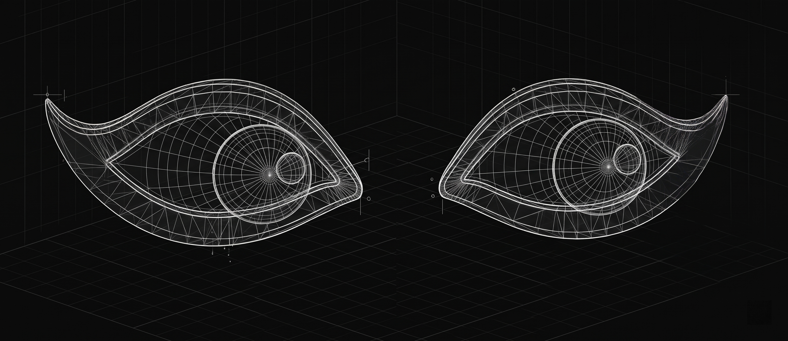

# Culture Meets Technology

An Onam celebration installation where Kerala's cultural artistry meets embedded technology.

<!-- portfolio: true -->

## Overview

When tradition meets innovation, even an Onam celebration can get a technology twist. Our IoT team brought the festive spirit to life with moving Kathakali eyes around the Pookalam, surrounded by glowing vilakku.

This project blended Kerala's rich cultural artistry with embedded electronics, servo motion and hands-on rapid prototyping.

## My contribution

I added a small technology touch to the Pookalam by making the Kathakali eyes move using servo motors. The mechanism was integrated into the physical installation so the eyes could create a memorable movement effect during the celebration.

## Engineering scope

- Servo motor actuation and movement control
- Embedded firmware for timed motion
- Circuit planning and wiring
- Mechanical integration into the cultural installation
- Rapid prototyping and hands-on testing

## Project assets

- [`Servo movement circuit`](images/circuit/servo-move.png)
- [`Kathakali eye 3D model`](3d_model/eye_new.step)
- [`Arduino firmware`](Sweep_eye/Sweep_eye.ino)
- Showcase photos and videos in [`images/img_showcase`](images/img_showcase)

## Reflection

A celebration where culture meets technology, tradition meets innovation, and creativity brings it all together.

Happy to be part of the Onam celebration at Cavin Infotech. Thank you to everyone who supported and encouraged the build.

## Related post

[View the LinkedIn project post](https://lnkd.in/p/gDJ_Hiyg)
